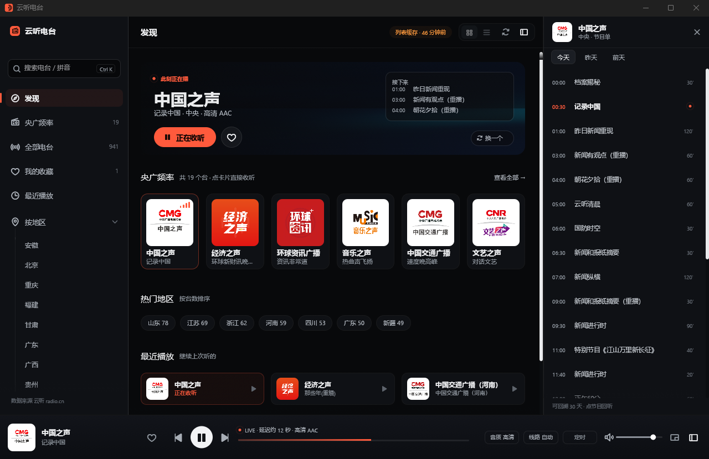
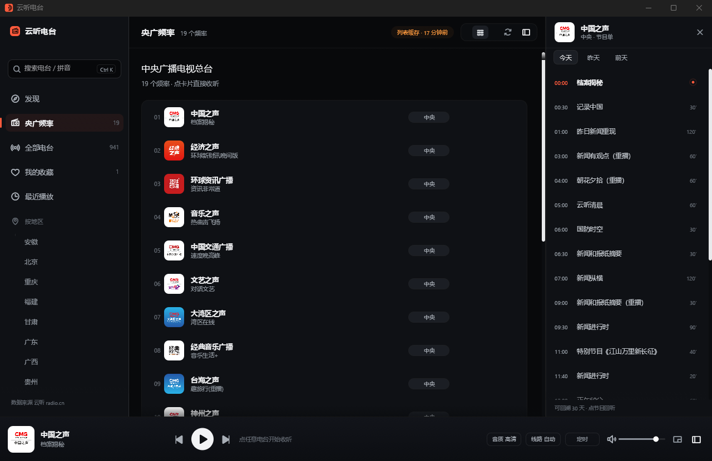

# 云听电台

用纯 Rust 编写的云听电台桌面客户端，支持 macOS / Windows / Linux。界面由 `egui` 自绘，
音频在内置解码器（libfdk-aac + symphonia）中完成，`cpal` 直接输出。


> **非官方客户端。** 与中央广播电视总台、云听无任何关联，仅供学习与个人使用。
> 音频与图文版权归原权利人所有；本程序不内置、不缓存、不分发任何音频内容。

收录央广 19 个频率与 31 个省级行政区的 900 多个电台：直播、节目单、整档回听、搜索、收藏与最近播放。





## 功能

**播放**

- 直播线路自动降级：`高清 AAC → 高清备用 → 标清 → 标清备用`，失败自动切换并在播放条标注当前线路。
- 断流自愈：重新调用详情接口取播放地址，最多重试 2 轮。
- 回听：节目单中任意一档整段回听，可拖动进度、从上次位置继续、一键回到直播。
- 暂停语义：直播暂停会停止播放并记住电台，恢复时重新解析地址、从最新位置起播。
- 睡眠定时（15–90 分钟）、音量持久化、双击音量图标静音。

**浏览与发现**

- 发现页：正在播 Hero（含「接下来」预告）、央广频率、热门地区、最近播放。
- 央广频率、全部电台（虚拟滚动）、按地区（31 个省级行政区）三个目录视图。
- 卡片 / 列表双视图；列表行显示台别与在播节目。

**搜索**

- 独立搜索结果页：侧栏输入关键词后点按钮或按 Enter 进入，`⌘/Ctrl K` 聚焦搜索框。
- 只走云听服务端，支持台名与拼音（`zgzs` → 中国之声）；每页 40 条，带首页 / 尾页。
- 服务端结果按 `contentId` 用本地目录补全台别与在播节目。

**节目单**

- 右侧面板可切今天 / 昨天 / 前天，打开时自动滚到正在播的一档。
- 点击节目回听；听过的节目行内显示进度。

**窗口与数据**

- 主窗 1280×800（最小 900×560）；无系统标题栏，macOS 保留原生红绿灯，Windows/Linux 自绘窗口按钮。
- 迷你模式：420×132，右下角还原按钮、双击空白处或 Esc 回到完整界面。
- 收藏、最近播放、回听进度与设置写在平台数据目录；收藏只存电台 ID，不存播放地址。

## 下载

从 [Releases](https://github.com/hex-ci/rust-radio/releases) 取最新版本：

| 平台 | 文件 | 安装方式 |
|---|---|---|
| macOS | `rust-radio_<版本>_macos_universal.dmg` | 通用二进制（Apple Silicon / Intel），打开后把「云听电台」拖进 Applications |
| Windows | `rust-radio_<版本>_windows_x64_setup.exe` | NSIS 安装器，双击安装 |
| Linux | `rust-radio_<版本>_linux_amd64.deb` | Debian / Ubuntu：`sudo apt install ./rust-radio_*.deb` |
| Linux | `rust-radio_<版本>_linux_amd64.AppImage` | 免安装：`chmod +x` 后直接运行 |
| Linux | `rust-radio_<版本>_linux_amd64.rpm` | Fedora / RHEL / openSUSE：`sudo dnf install ./rust-radio-*.rpm` |

macOS 包为 ad-hoc 签名、未做 Apple 公证，Gatekeeper 会拦（macOS 15 起右键「打开」已不能绕过）。
双击 DMG 就被挡住时，先去掉镜像的隔离标记再打开：

```bash
xattr -d com.apple.quarantine ~/Downloads/rust-radio_<版本>_macos_universal.dmg
```

拖进 Applications 后首次启动仍被拦，再对应用本体执行一次：

```bash
xattr -dr com.apple.quarantine "/Applications/云听电台.app"
```

不想敲命令行：打开「系统设置 → 隐私与安全性」，在“安全性”区域点对应条目的“仍要打开”。

## 快速开始

需要 rustup；编译器版本由仓库里的 `rust-toolchain.toml` 锁定（进入目录后 rustup 自动安装，当前 1.99.1），不用自己挑版本。解码器静态编进二进制；首次构建会编译随
`fdk-aac-sys` 附带的 libfdk-aac C++ 源码。

```bash
cargo run -p rust-radio-app                       # 启动
cargo run -p rust-radio-app -- --station 639      # 启动即播中国之声
cargo run -p rust-radio-app -- --mini             # 迷你窗口启动
cargo run -p rust-radio-app -- --view all         # 直接打开某个页面
```

构建依赖：

| 平台 | 需要 |
|---|---|
| macOS | Xcode Command Line Tools（clang / libc++） |
| Linux | `build-essential`、`pkg-config`、`libasound2-dev` |
| Windows | MSVC C++ 工具链（推荐，CI 也用 MSVC） |

### 打包

安装包统一用 [cargo-packager](https://github.com/crabnebula-dev/cargo-packager) 生成
（配置在 `crates/rust-radio-app/Cargo.toml` 的 `[package.metadata.packager]`）：

```bash
cargo install cargo-packager --locked
cargo build --release -p rust-radio-app

# macOS（.app / .dmg）
cargo packager -p rust-radio-app --release --formats dmg

# Windows（NSIS 安装器）
cargo packager -p rust-radio-app --release --formats nsis

# Linux（.deb / AppImage）
cargo packager -p rust-radio-app --release --formats deb,appimage

# Linux（RPM，cargo-packager 暂不支持，用 cargo-generate-rpm）
cargo install cargo-generate-rpm --locked
cargo generate-rpm -p crates/rust-radio-app --auto-req builtin -o dist/
```

产物在 `dist/`。版本号取自 `Cargo.toml` 的 `[workspace.package] version`。

`dist/` 与 `target/` 不入库。

## 发版

把 `[workspace.package] version` 改成目标版本并提交，然后推 tag：

```bash
git tag v0.1.0 && git push origin v0.1.0
```

`.github/workflows/release.yml` 会校验 tag 与 Cargo 版本一致，跑 fmt/clippy/test，
然后构建 macOS 通用 DMG（`lipo` 双架构）、Windows NSIS 安装器、Linux deb + AppImage + RPM，
创建 GitHub Release 并附 `SHA256SUMS.txt`。
也可在 Actions 页手动 dispatch（关掉发布开关则只保留 artifacts）。

## 自检

除单元测试外，程序内置三条可复现的验收命令：

```bash
cargo run -p rust-radio-app -- --selftest
# 接口 / 索引 / 搜索 / 直播出声 / 回听拖动，12 项断言

cargo run -p rust-radio-app -- --check-live --station 639
# 回听 → 回直播 → 点正在播的卡片暂停 / 继续，逐步断言状态

cargo run -p rust-radio-app -- --audit
# 轮换页面与播放态，检查手算坐标的控件/文字矩形是否重叠；带阳性对照
```

`--selftest` 会真的打开声卡（0.35 音量）；`--audit` 与 `--check-live` 会开窗，不适合作为 CI。

## 结构

```
crates/
├─ rust-radio-core/    接口层：签名、列表、详情、节目单、选流、磁盘缓存、电台目录索引
├─ rust-radio-audio/   音频引擎：内置解码 → 重采样 → 环形缓冲 → cpal，含状态机 / seek / 音量
└─ rust-radio-app/     egui 界面：主题、图标、图片缓存、各视图、播放条
```

设计细节、接口实测结论与取舍见 [`docs/ARCHITECTURE.md`](docs/ARCHITECTURE.md)。三个关键决定：

1. **解码内置，不外挂进程**：主线路是 HE-AAC v2，纯 Rust 的 symphonia 只支持 AAC-LC；
   AAC 交给静态编译的 libfdk-aac，MP4/MP3 用 symphonia，HLS/ADTS/MPEG-TS 由引擎自行处理。
2. **播放地址不落盘**：每次播放前重新调用详情接口取临时令牌，报错重连也必须重新取地址。
3. **降级必须可见**：缓存年龄、当前线路、限流文案都明确展示，不静默失败。

## 参与贡献

提交前请确保：

```bash
cargo fmt --all --check
cargo clippy --workspace --all-targets -- -D warnings
cargo test --workspace
```

注释与 UI 文案使用中文，标识符使用英文。涉及接口层的改动请先读 `docs/ARCHITECTURE.md`。

## 致谢

- [egui / eframe](https://github.com/emilk/egui)
- [libfdk-aac](https://github.com/mstorsjo/fdk-aac)
- [symphonia](https://github.com/pdeljanov/Symphonia)
- [Phosphor Icons](https://phosphoricons.com/)

## 许可

代码以 [MIT](LICENSE) 发布。
